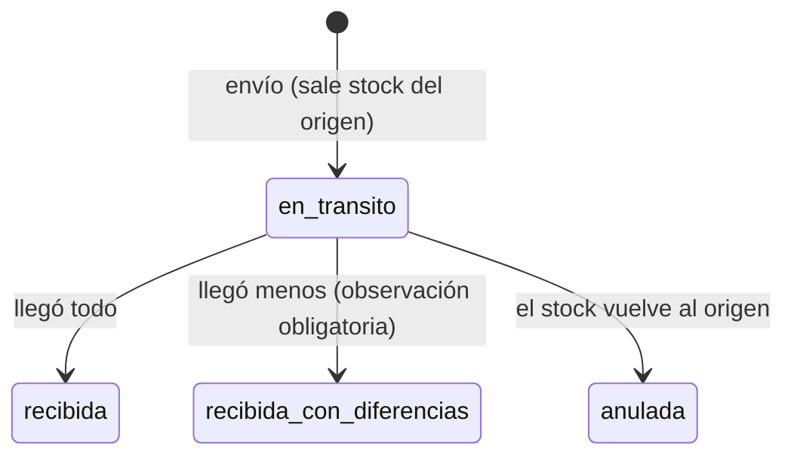

# 👗 Boutique Inventario

[](https://github.com/Angellec21/boutique-inventario/actions/workflows/ci.yml)


[](LICENSE)


API de inventario para **tiendas de ropa con varias sucursales**: cada prenda se controla por **talla y color**, con stock separado por tienda, alertas de reposición y kardex de movimientos. Montos en **bolivianos (Bs)**.

> ✅ **Versión 1.0.0** — catálogo, stock por sucursal, transferencias, ventas en caja, reportes del dueño, usuarios con roles, guardado en archivo con respaldo descargable y datos de ejemplo listos para probar. 139 pruebas automáticas. Ver el [registro de cambios](CHANGELOG.md).

## 💼 El problema

Una boutique de Santa Cruz con tiendas en el centro y en un mall suele llevar el inventario en cuadernos o en Excel por tienda. Las preguntas del día a día no tienen respuesta rápida:

- *«¿Tenemos esta blusa en talla M color beige? ¿En qué sucursal?»*
- *«¿Qué tallas se están acabando y hay que pedir al proveedor?»*
- *«¿Cuánta plata hay en mercadería en cada tienda?»*
- *«¿Por qué el conteo físico no cuadra con el sistema?»*
- *«¿Qué modelos y qué tallas se venden más? ¿Cuánto entró hoy por QR y cuánto en efectivo?»*

Boutique Inventario responde esas preguntas con una API que puede usar un sistema de caja, una app móvil o un panel web.

## ✨ Funcionalidades

| Módulo | Qué hace |
|---|---|
| **Catálogo** | Productos (modelos) con código, categoría, marca, precio y costo en Bs; margen por prenda; búsqueda sin importar tildes |
| **Variantes** | Combinaciones talla × color con **SKU automático** (`BLU-001-AZM-M`); se puede generar toda la matriz de una vez. Tallas XS–XXL, `UNICA` o numéricas (jeans 28–44) |
| **Stock por sucursal** | Ingresos de mercadería por SKU o id (todo o nada), ajustes por conteo físico con motivo obligatorio |
| **Kardex** | Cada movimiento queda registrado con cantidad, saldo, motivo y referencia (p. ej. n.º de pedido) |
| **Matriz de stock** | Tabla talla × color por producto, en una sucursal o en todas, con valor de la mercadería en Bs |
| **Alertas de reposición** | Variantes en o por debajo de su stock mínimo, con cuánto falta y cuánto hay en otras sucursales (para transferir antes de comprar) |
| **Transferencias** | Envío entre sucursales con código `TRF-00001`: el stock sale del origen y queda **en tránsito** hasta que el destino confirma. Recepción con conteo y registro de faltantes, o anulación con devolución al origen |
| **Ventas en caja** | Venta por SKU con código `V-CEN-000001`, descuento por línea (hasta 50 %), pago en efectivo (con cambio), QR o tarjeta. Todo o nada; precio y costo quedan congelados para calcular el margen real. Anulación con motivo que devuelve las prendas al stock |
| **Usuarios y roles** | Inicio de sesión con token JWT. El **administrador** (dueño) ve todo; el **encargado** opera solo su tienda y no ve costos, márgenes ni reportes. Contraseñas cifradas con PBKDF2 |
| **Respaldo** | El dueño descarga una copia completa del sistema en un clic (`GET /respaldo`); se restaura copiando el archivo y reiniciando |
| **Reportes del dueño** | Más vendidos por modelo o SKU con margen, ventas por talla (para decidir la curva de compra), cierre de caja por método de pago y vendedor, valor de la mercadería por sucursal a costo y a precio de venta |

## 🛠️ Tecnologías

- **Python 3.11+** y **FastAPI** (documentación OpenAPI automática en `/docs`)
- **Pydantic v2** para validación; montos con `Decimal`
- **PyJWT** para tokens de acceso; contraseñas con PBKDF2-SHA256 (`hashlib`)
- **pytest** + `TestClient` para pruebas de servicio y de API
- **GitHub Actions**: pruebas en Python 3.11, 3.12 y 3.13 en cada push y pull request

## 🏗️ Arquitectura

```
app/
├── models.py        # Modelos de dominio: Sucursal, Producto, Variante, Movimiento, Transferencia, Venta
├── inventario.py    # Reglas de negocio (servicio): SKU, stock, ajustes, alertas, transferencias, ventas
├── reportes.py      # Reportes de solo lectura: más vendidos, tallas, cierre de caja, valor de inventario
├── usuarios.py      # Usuarios, contraseñas cifradas y tokens JWT
├── persistencia.py  # Guardado y carga del estado en un archivo JSON (escritura atómica)
├── datos_ejemplo.py # Boutique de Santa Cruz de ejemplo (python -m app.datos_ejemplo)
├── schemas.py       # Esquemas de entrada de la API
└── main.py          # Rutas FastAPI, permisos por rol y mapeo de errores a HTTP
tests/
├── test_inventario.py          # Pruebas del servicio
├── test_transferencias.py      # Ciclo de vida de las transferencias
├── test_api.py                 # Pruebas de los endpoints
├── test_api_transferencias.py  # Endpoints de transferencias
├── test_ventas.py              # Ventas, descuentos, cambio y anulaciones
├── test_reportes.py            # Reportes del dueño
├── test_api_ventas.py          # Endpoints de ventas y reportes
├── test_usuarios.py            # Contraseñas, tokens y gestión de usuarios
├── test_api_auth.py            # Inicio de sesión y permisos por rol
├── test_persistencia.py        # Exportar/importar, archivo dañado, guardado atómico
├── test_api_persistencia.py    # Los cambios sobreviven a un reinicio del servidor
├── test_api_respaldo.py        # Estado del sistema, descarga y restauración del respaldo
└── test_datos_ejemplo.py       # Datos de ejemplo coherentes y reproducibles
```

La lógica de negocio vive en `Inventario`, sin depender de FastAPI: se prueba de forma aislada y la persistencia se puede cambiar sin tocar las rutas. Los errores de negocio se traducen a HTTP: `401` (sin sesión o token vencido), `403` (el rol no lo permite), `404` (no existe), `409` (duplicado o stock insuficiente) y `422` (dato inválido).

### Roles y permisos

| Acción | Administrador | Encargado de tienda |
|---|:---:|:---:|
| Sucursales, productos y variantes (crear) | ✅ | — |
| Consultar catálogo, SKU y matriz de stock de todas las tiendas | ✅ | ✅ (sin costo ni margen) |
| Ventas, ingresos, ajustes por conteo y alertas | ✅ | ✅ solo su sucursal |
| Enviar / recibir / anular transferencias | ✅ | ✅ si su tienda es origen / destino / origen |
| Ver ventas, transferencias y kardex | ✅ todo | ✅ solo su sucursal |
| Anular ventas | ✅ | — |
| Reportes (más vendidos, tallas, cierre de caja, valor de inventario) | ✅ | — |
| Usuarios (alta, baja, restablecer contraseña) | ✅ | — |

Los permisos se verifican en cada petición con el usuario guardado (no con lo que dice el token), así que una baja o un cambio de rol rige al instante. Una prueba automática recorre todas las rutas y verifica que ninguna privada responda sin sesión.

### Ciclo de una transferencia



Cada paso genera movimientos en el kardex con el código de la transferencia como referencia, así se puede rastrear una prenda de una tienda a otra.

## 🚀 Instalación

```bash
git clone https://github.com/Angellec21/boutique-inventario.git
cd boutique-inventario
python -m venv .venv && source .venv/bin/activate   # En Windows: .venv\Scripts\activate
pip install -r requirements-dev.txt

export BOUTIQUE_SECRET="$(python -c 'import secrets; print(secrets.token_urlsafe(32))')"
export BOUTIQUE_ADMIN_CLAVE="UnaClaveSegura2026"   # usuario: admin
uvicorn app.main:app --reload
```

Abrir la documentación interactiva en <http://localhost:8000/docs>, ingresar con `POST /auth/token` y pegar el token en el botón **Authorize**.

| Variable | Para qué |
|---|---|
| `BOUTIQUE_SECRET` | Firma de los tokens (mínimo 32 caracteres). Si falta se genera una al arrancar y las sesiones se pierden al reiniciar |
| `BOUTIQUE_ADMIN_USUARIO` | Usuario del primer administrador (por defecto `admin`) |
| `BOUTIQUE_ADMIN_CLAVE` | Su contraseña. Si falta se genera una aleatoria y se muestra una vez en la consola |
| `BOUTIQUE_DATOS` | Archivo donde se guarda todo (por defecto `data/boutique.json`) |

Los datos se guardan en un archivo JSON después de cada operación que los modifica y se cargan al arrancar. La escritura es atómica (archivo temporal + reemplazo), así que un corte de luz no deja el archivo a medias.

**Respaldo:** el administrador puede descargar una copia completa desde `GET /respaldo` (o desde `/docs`) sin entrar al servidor. Para restaurarla, se copia el archivo descargado en la ruta de `BOUTIQUE_DATOS` y se reinicia. El respaldo contiene las contraseñas solo cifradas y nunca el secreto de los tokens; aun así conviene guardarlo en un lugar seguro.

### Datos de ejemplo

Para probar el sistema sin cargar todo a mano hay una boutique cruceña de ejemplo: tres tiendas (Centro, Equipetrol y Ventura Mall), 8 modelos con 54 variantes, stock inicial, una transferencia con faltante, dos semanas de ventas (efectivo, QR y tarjeta, con descuentos y una anulación) y usuarios de demostración.

```bash
python -m app.datos_ejemplo            # escribe data/boutique.json (o BOUTIQUE_DATOS)
python -m app.datos_ejemplo --forzar   # reemplaza un archivo existente
uvicorn app.main:app --reload
```

| Usuario | Contraseña | Rol |
|---|---|---|
| `rosa` | `Boutique2026` | Administradora (dueña) |
| `carla.v` | `Equipetrol26` | Encargada de Equipetrol |
| `luis.r` | `Ventura2026` | Encargado de Ventura Mall |

> Son contraseñas de demostración: cámbielas (`POST /auth/clave`) antes de usar el sistema con datos reales.

### Pruebas

```bash
python -m pytest
```

## 📖 Uso rápido

```bash
# 0. Iniciar sesión (todas las rutas, salvo /salud, piden el token)
TOKEN=$(curl -s -X POST localhost:8000/auth/token -H 'Content-Type: application/json' \
  -d '{"usuario":"admin","clave":"UnaClaveSegura2026"}' | python -c 'import sys,json; print(json.load(sys.stdin)["access_token"])')
alias curl="curl -H 'Authorization: Bearer $TOKEN'"

# 1. Sucursal y producto
curl -X POST localhost:8000/sucursales -H 'Content-Type: application/json' \
  -d '{"codigo":"CEN","nombre":"Centro","direccion":"Calle 24 de Septiembre #155"}'
curl -X POST localhost:8000/productos -H 'Content-Type: application/json' \
  -d '{"codigo":"BLU-001","nombre":"Blusa de lino manga corta","categoria":"Blusas","precio_venta":"189","costo":"95"}'

# 2. Todas las variantes S/M/L en negro y beige
curl -X POST localhost:8000/productos/1/variantes/matriz -H 'Content-Type: application/json' \
  -d '{"tallas":["S","M","L"],"colores":["Negro","Beige"]}'

# 3. Ingreso de mercadería por SKU
curl -X POST localhost:8000/stock/ingresos -H 'Content-Type: application/json' \
  -d '{"sucursal_id":1,"referencia":"Pedido 0045","items":[{"sku":"BLU-001-NEG-M","cantidad":6}]}'

# 4. ¿Qué hay y qué falta?
curl localhost:8000/productos/1/stock
curl localhost:8000/sucursales/1/alertas

# 5. Enviar 2 blusas M al mall y confirmar la llegada (faltó 1)
curl -X POST localhost:8000/transferencias -H 'Content-Type: application/json' \
  -d '{"origen_id":1,"destino_id":2,"nota":"Vitrina fin de semana","items":[{"sku":"BLU-001-NEG-M","cantidad":2}]}'
curl -X POST localhost:8000/transferencias/1/recepcion -H 'Content-Type: application/json' \
  -d '{"items":[{"sku":"BLU-001-NEG-M","cantidad":1}],"observacion":"Faltó 1 en la bolsa"}'

# 6. Vender 2 blusas con 10 % de descuento, pago en efectivo
curl -X POST localhost:8000/ventas -H 'Content-Type: application/json' \
  -d '{"sucursal_id":1,"metodo_pago":"efectivo","monto_recibido":"400","vendedor":"Carla","items":[{"sku":"BLU-001-NEG-M","cantidad":2,"descuento_pct":"10"}]}'

# 7. Cierre de caja del día y lo más vendido del mes
curl "localhost:8000/reportes/resumen-ventas?desde=2026-10-26&hasta=2026-10-26&sucursal_id=1"
curl "localhost:8000/reportes/mas-vendidos?desde=2026-10-01&hasta=2026-10-31&por=variante"

# 8. Crear la cuenta de la encargada de la tienda 1
curl -X POST localhost:8000/usuarios -H 'Content-Type: application/json' \
  -d '{"usuario":"carla.v","nombre":"Carla Vaca","clave":"Centro2026","rol":"encargado","sucursal_id":1}'
```

Ejemplo de cierre de caja (`GET /reportes/resumen-ventas`):

```json
{
  "cantidad_ventas": 2,
  "ventas_anuladas": 1,
  "unidades": 5,
  "total": "997.10",
  "descuentos": "18.90",
  "ticket_promedio": "498.55",
  "margen": "487.10",
  "margen_pct": "48.9",
  "por_metodo_pago": { "efectivo": "827.00", "qr": "170.10" },
  "por_vendedor": { "Carla": "827.00", "Luis": "170.10" }
}
```

Ejemplo de matriz de stock (`GET /productos/1/stock`):

```json
{
  "codigo": "BLU-001",
  "tallas": ["S", "M", "L"],
  "colores": ["Beige", "Negro"],
  "celdas": { "Beige": { "S": 0, "M": 0, "L": 0 }, "Negro": { "S": 0, "M": 6, "L": 0 } },
  "total_unidades": 6,
  "valor_venta": "1134.00"
}
```

### Endpoints

| Método | Ruta | Descripción |
|---|---|---|
| `POST` | `/auth/token` | Iniciar sesión (usuario y contraseña → token) |
| `GET` | `/auth/yo` | Datos del usuario de la sesión |
| `POST` | `/auth/clave` | Cambiar mi contraseña |
| `POST` / `GET` | `/usuarios` | Crear y listar usuarios (admin) |
| `POST` | `/usuarios/{id}/baja` | Desactivar un usuario (admin) |
| `POST` | `/usuarios/{id}/clave` | Restablecer contraseña (admin) |
| `POST` / `GET` | `/sucursales` | Crear y listar sucursales |
| `POST` / `GET` | `/productos` | Crear y buscar productos (`?q=`, `?categoria=`) |
| `GET` | `/productos/{id}` | Detalle con margen y variantes con stock total |
| `POST` | `/productos/{id}/variantes` | Agregar una variante talla/color |
| `POST` | `/productos/{id}/variantes/matriz` | Generar todas las combinaciones |
| `GET` | `/variantes/sku/{sku}` | Buscar por SKU (lector de código) |
| `POST` | `/stock/ingresos` | Ingreso de mercadería a una sucursal |
| `POST` | `/stock/ajustes` | Ajuste por conteo físico |
| `GET` | `/productos/{id}/stock` | Matriz talla × color (`?sucursal_id=`) |
| `GET` | `/sucursales/{id}/alertas` | Variantes por reponer |
| `GET` | `/variantes/{id}/kardex` | Historial de movimientos |
| `POST` | `/transferencias` | Enviar mercadería a otra sucursal |
| `GET` | `/transferencias` | Listar (`?sucursal_id=`, `?estado=en_transito`) |
| `GET` | `/transferencias/{id}` | Detalle con unidades enviadas y faltantes |
| `POST` | `/transferencias/{id}/recepcion` | Confirmar llegada (todo o lo contado) |
| `POST` | `/transferencias/{id}/anulacion` | Anular el envío; el stock vuelve al origen |
| `POST` | `/ventas` | Registrar venta (por SKU o id, con descuento y método de pago) |
| `GET` | `/ventas` | Listar (`?sucursal_id=`, `?desde=`, `?hasta=` en formato AAAA-MM-DD) |
| `GET` | `/ventas/{id}` | Detalle con subtotales, descuento, total y cambio |
| `POST` | `/ventas/{id}/anulacion` | Anular la venta; las prendas vuelven al stock |
| `GET` | `/reportes/mas-vendidos` | Ranking (`?por=producto\|variante`, `?limite=`, fechas, sucursal) |
| `GET` | `/reportes/ventas-por-talla` | Unidades y % por talla (`?categoria=`) |
| `GET` | `/reportes/resumen-ventas` | Cierre de caja por método de pago y vendedor |
| `GET` | `/reportes/valor-inventario` | Mercadería por sucursal a costo y a precio de venta |
| `GET` | `/respaldo` | Descargar respaldo completo en JSON (admin) |
| `GET` | `/salud` | Estado, versión y modo de guardado (sin sesión) |

## 🗺️ Roadmap

- [x] Catálogo con variantes por talla y color
- [x] Stock por sucursal, ajustes y kardex
- [x] Alertas de stock mínimo
- [x] Transferencias entre sucursales (envío, recepción con faltantes y anulación)
- [x] Ventas con descuento de stock, descuentos por línea y anulaciones
- [x] Reportes: más vendidos, ventas por talla, cierre de caja, valor de inventario por sucursal
- [x] Usuarios y roles (encargado de tienda / administrador) con JWT
- [x] Persistencia en archivo JSON con guardado atómico
- [x] Datos de ejemplo de una boutique de Santa Cruz
- [x] Respaldo descargable por el administrador
- [ ] Base de datos SQLite/PostgreSQL para varias cajas a la vez
- [ ] Etiquetas con código de barras por SKU
- [ ] Importación del catálogo desde Excel
- [ ] Panel web para el encargado de tienda

## 📄 Licencia

[MIT](LICENSE) © 2026 Angel Emanuel Lecaro Quispe
